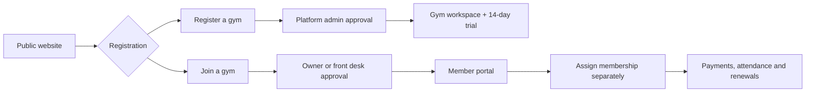
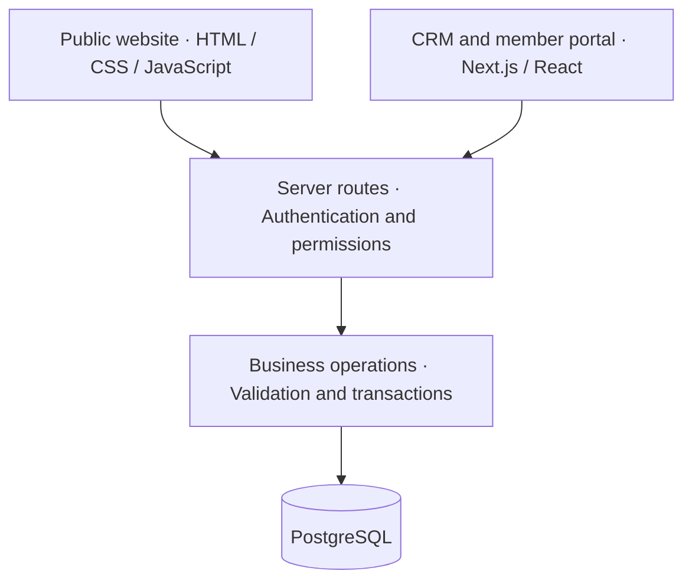

<div align="center">

# 🏋️ GYM CRM
### More momentum. Less admin.

A connected workspace for the people who keep a gym moving.

**Members · Memberships · Payments · Attendance · Personal Training**


**A full-stack case study in gym operations, role-based access, and reliable business records.**

</div>

---

## 🎬 The story starts at the front desk

A member walks in. Their membership has expired.

They made a partial payment last week. Their trainer has a session scheduled today. Someone needs to check the remaining dues, confirm access, and find the next renewal date.

That single conversation touches five different parts of a gym’s business.

**Gym CRM brings those records into one connected workflow.** It covers the journey from a first enquiry to an approved account, an active membership, a recorded payment, and a completed training session.

## 🎯 The challenge

The design problem was bigger than creating a dashboard:

> How do you give every person the information they need while keeping gym data, financial records, and account permissions consistent?

The project addresses three connected needs:

| Need | Product response |
| :--- | :--- |
| Keep everyday operations connected | Members, renewals, payments, attendance, and training share database-backed records. |
| Support different responsibilities | Five roles receive access appropriate to their work. |
| Preserve business history | Renewals, receipts, approval decisions, and audit records retain context over time. |

## 👥 One platform. Five perspectives.

| Role | Workspace |
| :--- | :--- |
| **Platform admin** | Manage gyms, platform plans, owner approvals, trials, and gym access. |
| **Gym owner** | Manage memberships, members, collections, leads, and the gym team. |
| **Front desk** | Handle member onboarding, attendance, payment records, and follow-ups. |
| **Trainer** | View assigned members and manage permitted training workflows. |
| **Member** | View personal memberships, payments, dues, and attendance. |

Permissions are checked on the server. The signed-in account determines access, including which gym’s records it can use.

## 🔄 From “I’m interested” to “I’m a member”



Public registration saves an account and a lead together. Accounts remain pending until approved.

Gym-owner approval provisions the gym and starts its one-time **14-day trial**. Member approval activates portal access; a paid membership is assigned separately.

Rejections retain their reason and decision history.

## 🧩 What the product can do

### Memberships that remember

Register members, create membership plans, track expiry dates, and renew access while preserving previous purchases.

### Payments with a paper trail

Record charges and partial payments, allocate payments against balances, track outstanding dues, and issue printable receipts with saved snapshots.

### Attendance at the front desk

Record check-ins and check-outs and see who is currently inside the gym.

### Leads that move forward

Capture enquiries, manage follow-ups, review registrations, and convert leads into members with membership and charge creation.

### Training with clear limits

Create trainer accounts, assign members and PT packages, schedule appointments, and track session credits. Appointment checks cover both trainer and member conflicts.

### A view of the business

Review collections, dues, expiring memberships, and scheduled sessions using saved records.

---

## 🛠️ Under the hood



| Layer | Technology |
| :--- | :--- |
| Application | Next.js, React, TypeScript |
| Public website | HTML, CSS, JavaScript with a separate Node.js server |
| Database | PostgreSQL through `pg` |
| Authentication | Email/password, salted scrypt hashes, database sessions |
| Icons | Lucide React |
| Database changes | Versioned SQL migrations |
| Verification | Type checking, production build, database checks, isolated integration script |

The public website runs separately from the CRM and connects to its registration endpoints.

## 🧠 The engineering decisions behind the experience

### 01 — A gym boundary belongs in the database, too

Server permissions restrict access by gym and role. Composite foreign keys also prevent records from referencing another gym’s data.

This gives tenant separation protection at both the application and database layers.

### 02 — Money needs exact arithmetic

Payment allocations use PostgreSQL decimal arithmetic and transaction checks against outstanding balances.

Financial writes use locking to protect totals when requests arrive together.

### 03 — A renewal should add history

Renewals preserve earlier purchases. Receipts retain the issued name and payment details as snapshots.

Later changes to a member’s profile do not rewrite an already-issued receipt.

### 04 — Completing a session should consume one credit

PT session completion runs inside a locked transaction, so repeating the action cannot consume the same session credit twice.

### 05 — Expiry is an access rule

Trial and subscription expiry are checked at login and on protected data requests. Gyms with expired access also disappear from the public registration list.

### 06 — Empty states are part of onboarding

The application starts without seeded accounts, plans, or customer records. A real administrator provisions the platform, and dashboards reflect the records entered.

## 🔐 Access and accountability

Implemented safeguards include:

- Salted scrypt password hashing.
- HttpOnly, same-site session cookies and hashed session tokens.
- Persistent login throttling and logout revocation.
- Session revocation when team accounts are deactivated.
- Parameterized database queries.
- Same-origin checks for state-changing requests.
- Audit records for business writes.
- Append-only protections for audit and PT ledger history.

Trainers receive assigned member data and cannot access payments or edit member profiles. Members receive only their own portal records.

---

## 🚀 Take it for a spin

### Prerequisites

- Node.js **22 or newer**
- pnpm
- A running PostgreSQL database and application user

### 1. Install dependencies

```bash
pnpm install
```

### 2. Configure the environment

Copy `.env.example` to `.env.local` and set your PostgreSQL credentials.

```dotenv
PGHOST=127.0.0.1
PGPORT=5434
PGDATABASE=gym_crm
PGUSER=gym_crm_app
PGPASSWORD=your_application_password
APP_ORIGIN=http://127.0.0.1:3000
WEBSITE_ORIGIN=http://127.0.0.1:3001
```

Keep `.env.local` private.

### 3. Prepare the database and administrator

```bash
pnpm db:migrate
pnpm admin:create
```

Administrator creation prompts for a name, email, and password. There are no default login credentials.

### 4. Start the CRM

```bash
pnpm dev
```

Open [the login page](http://127.0.0.1:3000/login).

### 5. Start the public website

In a second terminal:

```bash
pnpm website:dev
```

Open [the public website](http://127.0.0.1:3001).

Set `CRM_PUBLIC_URL` if the CRM uses a different public address.

## 🧭 Your first working gym

1. Sign in as the platform administrator.
2. Create a platform subscription plan.
3. Add a gym and its owner account, or approve a public gym registration.
4. Sign in as the owner and create membership plans.
5. Register members, assign memberships, and record payments.
6. Add staff and trainers, then manage attendance and PT appointments.

Public applicants can sign in after approval. Approval emails and account invitation delivery are not currently configured.

## 🧪 How verification is organized

```bash
pnpm typecheck
pnpm build
pnpm db:check
```

The repository also includes an integration verification script:

```bash
node scripts/verify-backend.mjs <path-to-database-admin-env-file>
```

It requires a production build and the expected database administrator configuration. It creates a temporary database, applies migrations, exercises application flows, and removes the temporary database afterward.

Fixture records stay out of the configured project database.

## 🗂️ A quick tour of the repository

```text
Gym_crm/
├── src/
│   ├── app/                 # Pages and API routes
│   ├── components/          # Login, role workspaces and member portal
│   └── lib/
│       ├── contracts.ts     # Shared types and formatting
│       └── server/          # Authentication, data access and business rules
├── website/                 # Public landing page and registration experience
├── db/
│   └── migrations/          # Versioned PostgreSQL schema changes
├── scripts/                 # Migration, provisioning and verification tools
└── DOCUMENTATION/
    └── output/              # Project and database design document
```

Read the [database notes](db/README.md) or explore the [project and database design document](DOCUMENTATION/output/GYM_CRM_Project_and_Database_Design.docx).

## 🏁 What this case study demonstrates

The implemented project connects public onboarding, approval, gym operations, and member self-service through persistent database records.

Its central engineering theme is **consistency across workflows**: a payment affects dues, a renewal preserves history, an approval activates the correct account, and a completed session consumes one credit.

Business impact metrics—such as time saved or renewal uplift—have not been measured. The case study focuses on the implemented behavior and the decisions supporting it.

## 🔭 The next set

Application flows still to build:

- Password recovery and email invitations.
- Approval notifications and messaging delivery.
- QR attendance scanning.
- CSV imports.
- Membership freeze and cancellation.
- Platform subscription payment entry.

Some supporting tables already exist; these user-facing workflows remain future work.

---

<div align="center">

### Stronger operations. More room for progress.

**GYM CRM — from the first enquiry to the next renewal.**

</div>
